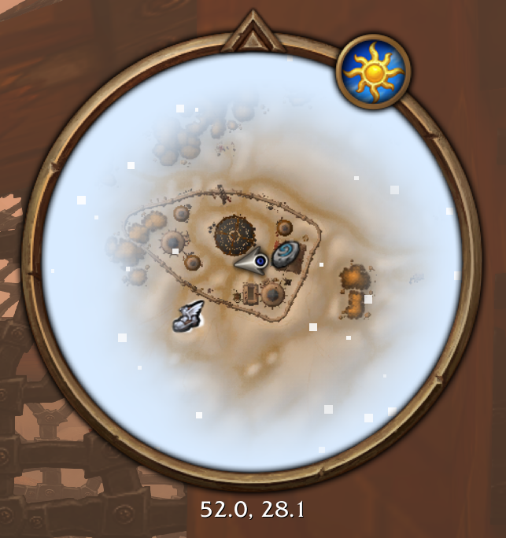
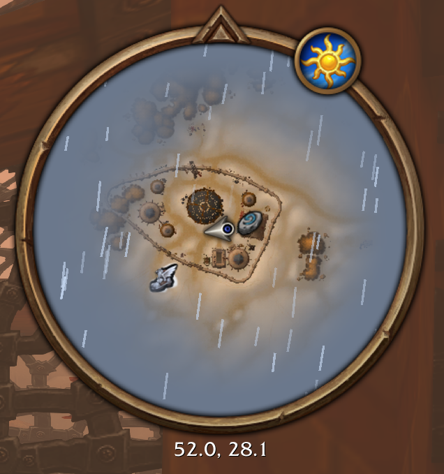
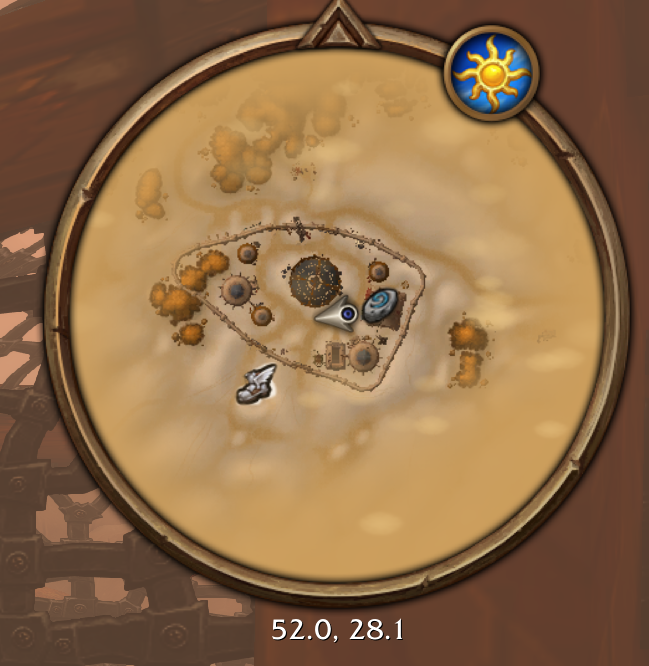

# WeatherMaps: Immersion

Live **snow, rain and sandstorm** on your **minimap** and **world map** for WoW Forever. When the weather
turns where you stand, a haze closes in around your position and drifting flakes, streaks or dust pass over
the map, so faint roads and terrain get harder to read the way they do when you are actually in the storm.

  

## What it does
- Reads your local weather from the game (`C_Weather.GetCurrentWeather()` and `WEATHER_CHANGED`). No guessing, no timers.
- **Snow:** white flakes and a pale blue haze. **Rain:** slanted streaks and a stormy grey haze. **Sandstorm:** wind-blown dust and a tan haze.
- Heavier storms mean more particles and a tighter, denser haze. The clear area around your arrow shrinks, drifts and breathes slowly, so visibility feels alive.
- A slow cloud layer and large soft puffs break up the haze so it is never a flat colour.
- **Minimap:** drawn over the terrain and under the compass ring, clipped to the circle.
- **World map:** drawn over the map art and under the pins and controls. Only shown on the map of the zone you are standing in.
- **Hidden indoors** (buildings, tunnels) and when the weather is clear.
- Never intercepts clicks or tooltips.

Known limit: the minimap draws its own arrow and tracking dots, so the overlay always sits above them. The clear centre and the `strength` setting keep them readable.

## Install
**CurseForge:** install with the CurseForge app, or download the zip and unpack it into `World of Warcraft\_forever_\Interface\AddOns\`.

**From GitHub:** copy the repository files the addon needs (`WeatherMapsImmersion.toc`, `WeatherMapsImmersion.lua` and the four `.tga` files) into a folder named `WeatherMapsImmersion` under `Interface\AddOns\`.

The first time, **fully restart the game**. New texture files are not picked up by `/reload`. At character select, tick **WeatherMaps: Immersion** under AddOns (tick **Load out of date AddOns** if it is greyed).

## Try it without waiting for a storm
`/weathermaps preview snow`, `/weathermaps preview rain`, `/weathermaps preview sand`, each with an optional intensity from 0 to 1, for example `/weathermaps preview sand 0.5`. Then `/weathermaps preview off`.

## Commands (`/weathermaps` or `/wmaps`)
| Command | Effect |
|---|---|
| (none) | status |
| `on` / `off` | enable or disable everything |
| `minimap [on\|off]`, `worldmap [on\|off]` | each surface on its own |
| `preview snow\|rain\|sand [0-1]` / `preview off` | try a look without waiting for a storm |
| `strength <0.3-2.5>` | master multiplier for every haze layer: haze, cloud and puffs (default 1.2) |
| `haze <0-1>` | minimap rim haze strength at full intensity (default 0.85) |
| `cloud <0-1>` | drifting cloud layer in the haze (default 0.8, 0 = off) |
| `puffs <0-14>`, `puffalpha <0-1>` | large soft puffs drifting over the maps, centre included (default 6 and 0.33; puffs 0 = off) |
| `density <n>` | particles at full intensity (default 60, max 150; rain uses 1.6x) |
| `speed <x>` | particle speed (default 1) |
| `breath <0-0.3>` | clear-zone swell (default 0.05, 0 = static) |
| `indoors [on\|off]` | hide inside buildings (default on) |
| `local [on\|off]` | world map overlay only on your own zone's map (default on) |
| `snowfade [on\|off]` | snow haze fades out near intensity 1.0 (default on, provisional) |
| `debug [on\|off]` | print weather changes to chat |
| `reset` | restore defaults |

Settings are saved per account in `WeatherMapsImmersionDB` when you exit the game normally.

## Notes and limits
- **Beta.** Snow and rain were checked against real storms. A real sandstorm was seen once, briefly (weather type 3, intensity about 0.5), so its look is tuned from that and from previews.
- Weather is regional. Starting areas and nearby areas can differ inside the same zone. The overlay follows whatever the game reports for your position.
- In the one snow storm captured, the top stage (intensity 1.0) lost its fog, so snow haze fades near 1.0. That is provisional (`snowfade`).
- Fog is not a weather type the game reports. In the storms we saw it came with the rain and snow stages, so there is no separate fog effect.
- Not yet checked: a second storm of each type, caves, minimap rotation and zoom.

Technical findings about the client (what the weather API returns, how layering works, storm timings) are in [docs/client-findings.md](docs/client-findings.md).

## Credits and license
MIT licensed, see [LICENSE](LICENSE). Copyright (c) 2026 AetraDev.

Art: the cloud tile, haze vignette and ring mask are generated by the scripts in [tools](tools). The puff sprite was created with AI image generation and then cleaned up and converted by `tools/make_puff.py`; its source image is in `art/`.
